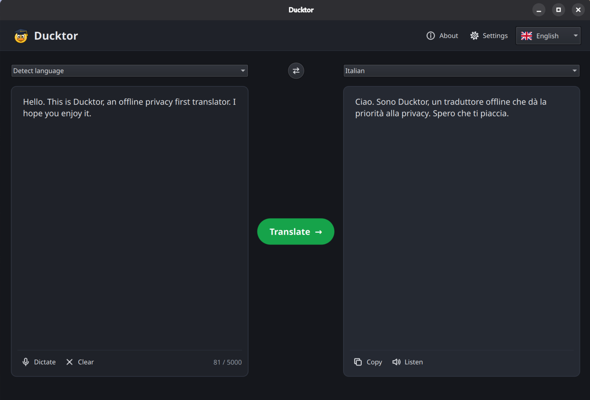

<div align="center">
  
</div>

<h1 align="center">Ducktor</h1>

<p align="center">
  
  
  
  
  
  
</p>

<p align="center">
  <strong>Ducktor is an offline, free, open source, privacy-first desktop translator</strong><br>
  Text or voice input, translation with local AI models and read-aloud output.  
</p>

<div align="center">
  
</div>

> [!WARNING]
> Translation quality depends on the models you download. Larger models generally produce better translations, but they need more RAM and CPU.

If you want to stop using Google or any other big company's translation product, have full privacy, or need to translate things without any internet access, Ducktor is for you.

An initial internet connection is needed to download the models locally. After that, the app works 100% offline.

This software is still in alpha. It has been successfully tested on Linux. Since we don't have Windows or macOS computers, those platforms are not yet fully tested, so let us know if you find any bugs.

## If you want to download

If you just want to download the app and use it, go to the [Release page](https://github.com/Celtic-Bytes/Ducktor/releases).

## If you are a developer

### Technologies in brief

| Piece                                                                                                                                                        | What it is                              | Why Ducktor uses it                                               |
| ------------------------------------------------------------------------------------------------------------------------------------------------------------ | --------------------------------------- | ----------------------------------------------------------------- |
| [C++](https://isocpp.org/)                                                                                                                                   | Compiled programming language           | Runs the AI engines efficiently on modest CPUs                    |
| [Qt](https://doc.qt.io/qt-6/)                                                                                                                                | Cross-platform toolkit for desktop apps | Window, buttons, audio and downloads on Linux, Windows and macOS  |
| [QML / Qt Quick](https://doc.qt.io/qt-6/qtquick-index.html)                                                                                                  | Qt's language for describing interfaces | The screens in the [qml](qml) folder                              |
| [CMake](https://cmake.org/cmake/help/latest/)                                                                                                                | Build system                            | Turns the source code into executables                            |
| [Ninja](https://ninja-build.org/)                                                                                                                            | Fast build runner used by CMake         | Required by the presets in [CMakePresets.json](CMakePresets.json) |
| [llama.cpp](https://github.com/ggml-org/llama.cpp), [whisper.cpp](https://github.com/ggml-org/whisper.cpp), [Piper](https://github.com/OHF-Voice/piper1-gpl) | Local AI engines                        | Translation, speech recognition and speech synthesis              |

### Architecture

- Interface: Qt 6.9+ with Qt Quick and C++ ([Qt documentation](https://doc.qt.io/qt-6/)).
- Each inference engine is a separate helper program that communicates through local pipes, with no server or network:
  - `ducktor-translate`: [llama.cpp](https://github.com/ggml-org/llama.cpp) `v0.7.0` with GGUF models.
  - `ducktor-transcribe`: [whisper.cpp](https://github.com/ggml-org/whisper.cpp) `v1.9.5`.
  - `ducktor-speak`: [libpiper](https://github.com/OHF-Voice/piper1-gpl/tree/main/libpiper) `v1.8.0`.
- If a model runs out of memory or crashes, its process is closed and the interface keeps responding.
- Models are downloaded from Settings, with resumable downloads and SHA-256 verification, or imported from a local file.

### What to install

You need five things: a C++ compiler, CMake, Ninja, Git and Qt 6.9 or later. Qt must include the **Qt Multimedia** module, which is not selected by default in the Qt installer.

#### Windows 10/11

1. Install Git, CMake, Ninja and the Microsoft C++ compiler from PowerShell:

   ```powershell
   winget install Git.Git Kitware.CMake Ninja-build.Ninja
   winget install Microsoft.VisualStudio.2022.BuildTools --override "--wait --passive --add Microsoft.VisualStudio.Workload.VCTools --includeRecommended"
   ```

   The second command installs [Visual Studio Build Tools](https://visualstudio.microsoft.com/visual-cpp-build-tools/), which are free; the full Visual Studio IDE is not needed.

2. Install Qt with the [Qt Online Installer](https://doc.qt.io/qt-6/get-and-install-qt.html) (it asks for a free Qt account). In the component list, open the latest Qt 6 version (6.9 or later) and select:
   - **MSVC 2022 64-bit**
   - **Additional Libraries → Qt Multimedia**

   Qt is installed by default in a folder such as `C:\Qt\6.9.3\msvc2022_64`. Write down the exact path: you will need it.

3. Restart the computer so the new programs are found.

Build commands on Windows must run in the **x64 Native Tools Command Prompt for VS 2022** (search for it in the Start menu), which prepares the compiler.

#### Linux (Debian, Ubuntu, PikaOS)

1. Install the build tools and the system libraries Qt needs:

   ```bash
   sudo apt install build-essential cmake ninja-build git libgl1-mesa-dev libxkbcommon-dev libxcb-cursor0 libpulse-dev
   ```

   CMake must be 3.24 or later (`cmake --version`).

2. Install Qt with the [Qt Online Installer](https://doc.qt.io/qt-6/get-and-install-qt.html), selecting **Desktop gcc 64-bit** and **Additional Libraries → Qt Multimedia** for Qt 6.9 or later. The default path looks like `~/Qt/6.9.3/gcc_64`.

   Your distribution's Qt packages also work if `apt policy qt6-base-dev` shows version 6.9 or later (PikaOS ships a recent enough Qt). In that case, install these packages instead and skip `CMAKE_PREFIX_PATH` below: 

   ```bash
   sudo apt install qt6-base-dev qt6-declarative-dev qt6-multimedia-dev qt6-svg-dev qt6-tools-dev \
       qml6-module-qtquick qml6-module-qtquick-controls qml6-module-qtquick-layouts \
       qml6-module-qtquick-dialogs qml6-module-qtquick-window qt6-svg-plugins qml6-module-qtquick-templates \
       qml6-module-qtqml-workerscript
   ```

   The `qml6-module-*` packages are needed to start the app; without them Ducktor exits with a message such as `module "QtQuick.Controls" is not installed`.

> To find where the Qt libraries were installed, run:
> - The command `qmake6 -query QT_INSTALL_PREFIX 2>/dev/null || qt6-qmake -query QT_INSTALL_PREFIX` if you installed it using *apt* 
> - Or the command `ls -d ~/Qt/[0-9]*` if you used the online installer.

### Run in development mode

#### From the terminal

Replace the Qt path with yours:

```bash
cmake --preset dev -DCMAKE_PREFIX_PATH=/path/to/Qt/6.9.3/gcc_64
cmake --build --preset dev
ctest --preset dev
./build/dev/bin/ducktor
```

On Windows, use the Windows path (`-DCMAKE_PREFIX_PATH=C:/Qt/6.9.3/msvc2022_64`) and start the app with `build\dev\bin\ducktor.exe`. Before starting it, add Qt to the `PATH` of that terminal, otherwise Windows cannot find the Qt DLLs:

```bat
set PATH=C:\Qt\6.9.3\msvc2022_64\bin;%PATH%
```

What to expect:

- The first configuration downloads llama.cpp, whisper.cpp and Piper, and the first build compiles them. It can take a long time; later builds are much faster.
- Everything you need after building is in `build/<preset>/bin`: `ducktor` (the app), the `ducktor-*` engine helpers and `espeak-ng-data`. The rest of the `build` folder is intermediate files.
- If an engine fails to build, you can still build and start the app alone with `cmake --build --preset dev --target ducktor`; the missing engine's features will report that a component is missing.
- Keep the repository in a reasonably short path (for example `~/projects/Ducktor`): eSpeak NG, used by Piper, fails with very long build paths.
- With your distribution's Qt, configuration may print many `The qml plugin '...' ... will not be linked` warnings. They are harmless: those plugins are loaded from the system when Ducktor starts.
- Ducktor starts with no AI models. Open **Settings** and download at least one translation model; for voice input and output, also download a speech recognition model and a voice. The recommended set is about 1.5 GB.
- To work only on the interface, use the `ui-only` preset instead of `dev`: it skips the engines, so it builds quickly, but translation and voice will report that a component is missing.
- To see the engines' diagnostic output, set the environment variable `DUCKTOR_DEBUG_ENGINES=1` before starting Ducktor. Their output can include fragments of the processed text, so use it only for debugging.

#### From Visual Studio Code

1. Open the repository folder in VS Code and install the recommended extensions when prompted. They are listed in [.vscode/extensions.json](.vscode/extensions.json):
   - [CMake Tools](https://marketplace.visualstudio.com/items?itemName=ms-vscode.cmake-tools): configure, build, test and run from the status bar.
   - [C/C++](https://marketplace.visualstudio.com/items?itemName=ms-vscode.cpptools): code completion and debugging.
   - [Qt Extension Pack](https://marketplace.visualstudio.com/items?itemName=theqtcompany.qt): QML highlighting and Qt tools.
2. So you do not have to type the Qt path every time, create a file named `CMakeUserPresets.json` in the repository root. It is personal and ignored by Git:

   ```json
   {
     "version": 6,
     "configurePresets": [
       {
         "name": "my-dev",
         "inherits": "dev",
         "cacheVariables": { "CMAKE_PREFIX_PATH": "C:/Qt/6.9.3/msvc2022_64" }
       }
     ],
     "buildPresets": [{ "name": "my-dev", "configurePreset": "my-dev" }],
     "testPresets": [{ "name": "my-dev", "configurePreset": "my-dev" }]
   }
   ```

   With your distribution's Qt on Debian, Ubuntu or PikaOS, use `"Qt6_DIR": "/usr/lib/x86_64-linux-gnu/cmake/Qt6"` instead of `CMAKE_PREFIX_PATH`. Without one of them, VS Code shows the error `Could not find a package configuration file provided by "Qt6"`.

3. In the CMake panel, select the `my-dev` configure preset, then use **Build**, **Run Tests** and **Launch** (or **Debug**) with the `ducktor` target.

On Windows, start VS Code from the _x64 Native Tools Command Prompt for VS 2022_ (run `code .` in the repository folder) so CMake can find the compiler.

### Packages

Packages are created with the `release` preset (or `release-rpm` for the RPM), which builds engines that run on any CPU of the same architecture. All finished packages are written to the `dist` folder in the repository. None of them include AI models: users download them from _Settings_.

| System  | Format                          | Command                                                                              | Result                                    |
| ------- | ------------------------------- | ------------------------------------------------------------------------------------ | ----------------------------------------- |
| Linux   | `.deb` (Debian, Ubuntu, PikaOS) | `cmake --workflow --preset package`                                                  | `dist/ducktor_<version>_amd64.deb`        |
| Linux   | `.tar.xz` (other distributions) | `cmake --workflow --preset package`                                                  | `dist/ducktor-<version>-linux-x86_64.tar.xz` |
| Linux   | RPM (Fedora, openSUSE, ...)     | see [RPM (Fedora)](#rpm-fedora)                                                      | `dist/ducktor-<version>-1.x86_64.rpm`     |
| Linux   | AppImage (portable)             | `bash packaging/linux/build-appimage.sh`                                             | `dist/Ducktor-<version>-x86_64.AppImage`  |
| Linux   | Flatpak                         | see [Flatpak](#flatpak)                                                              | `dist/Ducktor-<version>.flatpak`          |
| Linux   | AUR (Arch, from source)         | see [Arch (AUR)](#arch-aur)                                                          | `ducktor-<version>-1-x86_64.pkg.tar.zst`  |
| Windows | Portable ZIP                    | `cmake --preset release -DCMAKE_PREFIX_PATH=C:/Qt/6.9.3/msvc2022_64`, build, `cpack` | `dist/Ducktor-<version>-windows-x64.zip`  |
| macOS   | `.app` inside a ZIP             | same as Windows, with your Qt path                                                   | `dist/Ducktor-<version>-macos-<arch>.zip` |
| macOS   | DMG (drag and drop)             | `bash packaging/macos/build-dmg.sh` after `cpack`                                    | `dist/Ducktor-<version>-macos-<arch>.dmg` |
| macOS   | `.pkg` (installer)              | `bash packaging/macos/build-pkg.sh` after `cpack`                                    | `dist/Ducktor-<version>-macos-<arch>.pkg` |

Rules that apply to every format:

- Each system's packages must be built on that system: Linux packages on Linux, the ZIP for Windows on Windows and the one for macOS on a Mac.
- A Linux package only runs on distributions at least as new as the one that built it. For packages meant for other people, build on the oldest distribution you want to support.
- Every package includes [LICENSE](LICENSE), [PRIVACY.md](PRIVACY.md), [THIRD_PARTY_NOTICES.md](THIRD_PARTY_NOTICES.md) and a `licenses` folder with the license texts of the bundled components.
- The version comes from `project(Ducktor VERSION ...)` in [CMakeLists.txt](CMakeLists.txt); the Linux release date and notes are in [packaging/linux/com.celticbytes.Ducktor.metainfo.xml](packaging/linux/com.celticbytes.Ducktor.metainfo.xml).

#### .deb

Needs your distribution's Qt (see [What to install](#linux-debian-ubuntu-pikaos)) and the `dpkg-dev` package:

```bash
sudo apt install dpkg-dev
cmake --workflow --preset package
sudo apt install ./dist/ducktor_0.1.1_amd64.deb
```

The package installs Ducktor in `/usr/bin`, its engines in `/usr/libexec/ducktor` and adds it to the applications menu. Its dependencies are calculated automatically from the Qt packages installed on the build machine. To uninstall it: `sudo apt remove ducktor`.

#### .tar.xz

The same FHS layout as the `.deb` as a plain tarball, for distributions without a package:

```bash
cmake --workflow --preset package
sudo tar -xJf dist/ducktor-0.1.1-linux-x86_64.tar.xz -C /
```

It needs the same Qt libraries as the `.deb` (see [What to install](#linux-debian-ubuntu-pikaos)). Nothing is installed through the package manager, so to remove it delete the files it placed under `/usr` (the same list the `.deb` contains).

#### RPM (Fedora)

For the RPM family, build on that family with its Qt packages (the release workflow tests Fedora 44):

```bash
sudo dnf install cmake ninja-build gcc-c++ make git rpm-build \
    qt6-qtbase qt6-qtbase-gui qt6-qtdeclarative qt6-qtmultimedia qt6-qtsvg \
    qt6-qtbase-devel qt6-qtdeclarative-devel qt6-qtmultimedia-devel qt6-qtsvg-devel \
    qt6-qttools-devel
cmake --workflow --preset package-rpm
sudo dnf install ./dist/ducktor-0.1.1-1.x86_64.rpm
```

It installs the same layout as the `.deb`, and its dependencies are derived from the standard `qt6-*` packages, including the QML modules that Ducktor loads at runtime (see [cmake/FedoraQtDepends.cmake](cmake/FedoraQtDepends.cmake)). To uninstall it: `sudo dnf remove ducktor`.

#### AppImage

A single file that runs without installing anything and carries its own copy of Qt:

```bash
bash packaging/linux/build-appimage.sh
chmod +x dist/Ducktor-0.1.1-x86_64.AppImage
./dist/Ducktor-0.1.1-x86_64.AppImage
```

- The script downloads two pinned versions of [linuxdeploy](https://github.com/linuxdeploy/linuxdeploy) and its [Qt plugin](https://github.com/linuxdeploy/linuxdeploy-plugin-qt) into `build/appimage-tools`, and checks their SHA-256 before running them.
- With your distribution's Qt it also needs `qmake6` and `qmlimportscanner` (`sudo apt install qt6-base-dev-tools qt6-declarative-dev-tools`).
- The Qt plugin requires the SVG icon engine (`qt6/plugins/iconengines/libqsvgicon.so`) to exist, because Ducktor links Qt6::Svg. On Debian and Ubuntu it is part of `libqt6svg6`; on PikaOS it is in a separate package: `sudo apt install qt6-svg-plugins`.
- With the Qt Online Installer, pass your Qt path and its `qmake`: `QMAKE=~/Qt/6.9.3/gcc_64/bin/qmake bash packaging/linux/build-appimage.sh -DCMAKE_PREFIX_PATH=$HOME/Qt/6.9.3/gcc_64`.

#### Flatpak

Builds against the KDE 6.10 runtime, which already contains Qt. Install the tools and the runtime once:

```bash
sudo apt install flatpak flatpak-builder
flatpak remote-add --user --if-not-exists flathub https://dl.flathub.org/repo/flathub.flatpakrepo
flatpak install --user flathub org.kde.Platform//6.10 org.kde.Sdk//6.10
```

Then build, export a single file and install it:

```bash
flatpak-builder --user --force-clean --repo=build/flatpak-repo build/flatpak packaging/flatpak/com.celticbytes.Ducktor.yml
flatpak build-bundle build/flatpak-repo dist/Ducktor-0.1.1.flatpak com.celticbytes.Ducktor
flatpak install --user dist/Ducktor-0.1.1.flatpak
flatpak run com.celticbytes.Ducktor
```

The manifest ([packaging/flatpak/com.celticbytes.Ducktor.yml](packaging/flatpak/com.celticbytes.Ducktor.yml)) allows network access during the build because the engines download their sources. That is fine for local builds; publishing on Flathub would require listing every source in the manifest instead.

#### Arch (AUR)

The [PKGBUILD](packaging/arch/PKGBUILD) builds Ducktor from source with the `release` preset, so it needs network access (the engines download their sources) and a while to finish. For local use:

```bash
cd packaging/arch
makepkg -si
```

To publish it to the AUR, create a package named `ducktor` in the user repository and copy the PKGBUILD there. When a new release tag is cut, bump `pkgver` and recalculate `sha256sums` from the tarball of that tag.

#### Windows ZIP

In the _x64 Native Tools Command Prompt for VS 2022_, with your Qt path:

```bat
cmake --preset release -DCMAKE_PREFIX_PATH=C:/Qt/6.9.3/msvc2022_64
cmake --build --preset release
cpack --preset release
```

The ZIP contains `ducktor.exe`, its engines, Qt (copied by `windeployqt`) and the Microsoft C++ runtime. Unzip it anywhere and run `ducktor.exe`. It includes a `portable.txt` file, so settings and models are stored in a `data` folder next to the program; delete that file to use your user profile instead. The program is not signed, so Windows SmartScreen may ask for confirmation the first time (_More info → Run anyway_).

#### macOS ZIP, DMG and pkg

In Terminal, with Xcode Command Line Tools (`xcode-select --install`) and your Qt path:

```bash
cmake --preset release -DCMAKE_PREFIX_PATH=$HOME/Qt/6.9.3/macos
cmake --build --preset release
cpack --preset release
```

The ZIP contains `Ducktor.app` (with Qt copied by `macdeployqt`) and the license documents. The app has an ad hoc signature but is not notarized by Apple, so the first time you must right-click it and choose _Open_. macOS asks for microphone permission the first time you dictate.

For a DMG instead, run [packaging/macos/build-dmg.sh](packaging/macos/build-dmg.sh) after `cpack`; it reuses the ZIP, so both formats contain exactly the same files:

```bash
bash packaging/macos/build-dmg.sh
hdiutil attach dist/Ducktor-0.1.1-macos-arm64.dmg
```

The DMG contains `Ducktor.app` and a link to `/Applications` for drag-and-drop installation.

For a classic installer, run [packaging/macos/build-pkg.sh](packaging/macos/build-pkg.sh) after `cpack`; it reuses the ZIP, so the `.pkg` installs exactly the same app:

```bash
bash packaging/macos/build-pkg.sh
sudo installer -pkg dist/Ducktor-0.1.1-macos-arm64.pkg -target /
```

The `.pkg` installs `Ducktor.app` into `/Applications`.

#### Portable mode

Any copy of Ducktor becomes portable if an empty `portable.txt` file sits next to the executable (next to `Ducktor.app` on macOS): settings and models are then stored in a `data` folder beside it.

#### Icons

The logo is [resources/icons/ducktor.svg](resources/icons/ducktor.svg). The Linux PNG sizes, the Windows `.ico` and the macOS `.icns` are generated from it and committed to the repository. After changing the SVG, regenerate them with [Node.js](https://nodejs.org/):

```bash
cd packaging/icons
npm ci
npm run generate
```

#### Automated releases (GitHub Actions)

The public repository is [github.com/Celtic-Bytes/Ducktor](https://github.com/Celtic-Bytes/Ducktor), mirrored from a private self-hosted instance. Pushing a version tag runs the release workflow:

| Trigger                                   | What runs                                                                                                                                          |
| ----------------------------------------- | -------------------------------------------------------------------------------------------------------------------------------------------------- |
| `git push origin v<version>`              | Builds all the packages, creates the release and uploads them                                                                                       |
| Manual run (_Actions → Releases → Run workflow_) | Builds the same packages but never touches the release: a way to test the pipeline without a tag; a checkbox additionally runs the slow full Arch source build |

[.github/workflows/releases.yml](.github/workflows/releases.yml) builds all the packages on GitHub's public runners and publishes them as a GitHub release:

| Package | Runner | How it is built |
| --- | --- | --- |
| `.deb` | `ubuntu-24.04` | `cmake --preset release` + `cpack --preset release` |
| `.tar.xz` | `ubuntu-24.04` | the same job as the `.deb`, also generated by `cpack --preset release` |
| RPM (Fedora) | `ubuntu-24.04` (Fedora 44 container) | `cmake --preset release-rpm` + `cpack --preset release-rpm`; the requires are checked and the package is installed in the container |
| AppImage | `ubuntu-24.04` | [packaging/linux/build-appimage.sh](packaging/linux/build-appimage.sh) (linuxdeploy with pinned SHA-256) |
| Flatpak | `ubuntu-24.04` | `flatpak-builder` with the Flathub KDE 6.10 runtime ([.github/workflows/releases.yml](.github/workflows/releases.yml), flatpak job) |
| Arch PKGBUILD | `ubuntu-24.04` (Arch container) | `makepkg --printsrcinfo` validation; the full source build is opt-in through the checkbox |
| Windows ZIP | `windows-latest` | `cmake --preset release` + `cpack --preset release` (portable, `windeployqt`) |
| macOS ZIP | `macos-latest` | `cmake --preset release` + `cpack --preset release` (`Ducktor.app`, ad hoc signature) |
| macOS DMG | `macos-latest` | [packaging/macos/build-dmg.sh](packaging/macos/build-dmg.sh) from the ZIP (`hdiutil`) |
| macOS pkg | `macos-latest` | [packaging/macos/build-pkg.sh](packaging/macos/build-pkg.sh) from the ZIP (`pkgbuild`, installs to /Applications) |

Qt is installed with [jurplel/install-qt-action](https://github.com/jurplel/install-qt-action) (aqt) from the qt.io online installer; the community edition needs no account or token. The engine sources and the Flathub runtime download from the internet during the build.

A second workflow, [.github/workflows/ci.yml](.github/workflows/ci.yml), runs on every push and pull request to `main`: it builds the interface with the `ui-only` preset (no engines, so it is fast) and runs the test suite with `ctest --preset ui-only`. Its status is the `CI` badge in the header.

The release procedure — the tag must match the version:

1. Bump `project(Ducktor VERSION ...)` in [CMakeLists.txt](CMakeLists.txt) and commit.
2. Bump `pkgver` in [packaging/arch/PKGBUILD](packaging/arch/PKGBUILD) and commit.
3. `git tag v<version> && git push origin v<version>`.
4. Recalculate the PKGBUILD `sha256sums` from the tarball of the new tag and commit (the tarball contains the PKGBUILD itself, so its hash is only known once the tag exists), and push the updated PKGBUILD to the AUR.

The workflow fails before compiling if the pushed tag does not match the project version, and it fails in the Arch job if the PKGBUILD does not validate.

### Roadmap

The _Settings_ page only lists models that Ducktor can run today. These newer engines are being evaluated and will appear there once they are integrated and tested on 8 GB CPU-only computers:

| Capability         | Candidates                                                                                                                                                                                       | Status                                                                                 |
| ------------------ | ------------------------------------------------------------------------------------------------------------------------------------------------------------------------------------------------ | -------------------------------------------------------------------------------------- |
| Speech recognition | [Parakeet TDT 0.6B v3](https://huggingface.co/nvidia/parakeet-tdt-0.6b-v3), [Qwen3-ASR 0.6B](https://huggingface.co/Qwen/Qwen3-ASR-0.6B), [Moonshine](https://github.com/moonshine-ai/moonshine) | Need a native C/C++ runtime in a new helper                                            |
| Voices             | [Kokoro 82M](https://huggingface.co/hexgrad/Kokoro-82M), [Qwen3-TTS](https://github.com/QwenLM/Qwen3-TTS)                                                                                        | Need a native runtime; Piper voices for Hebrew, Japanese and Thai need new phonemizers |

## Privacy

Ducktor has no accounts, telemetry or history, and your text and voice never leave your computer. It only connects to the internet when you download a model. Details: [PRIVACY.md](PRIVACY.md).

## License

Copyright (C) 2026 celticbytes.

Ducktor is free software: you can redistribute it and/or modify it under the terms of the [GNU General Public License](LICENSE), version 3 or (at your option) any later version. It is distributed in the hope that it will be useful, but **without any warranty**; machine translations and transcriptions can contain errors, so check them before relying on them for important matters.

Third-party components and their licenses are listed in [THIRD_PARTY_NOTICES.md](THIRD_PARTY_NOTICES.md). Each AI model has its own license, shown in Settings before downloading it.
